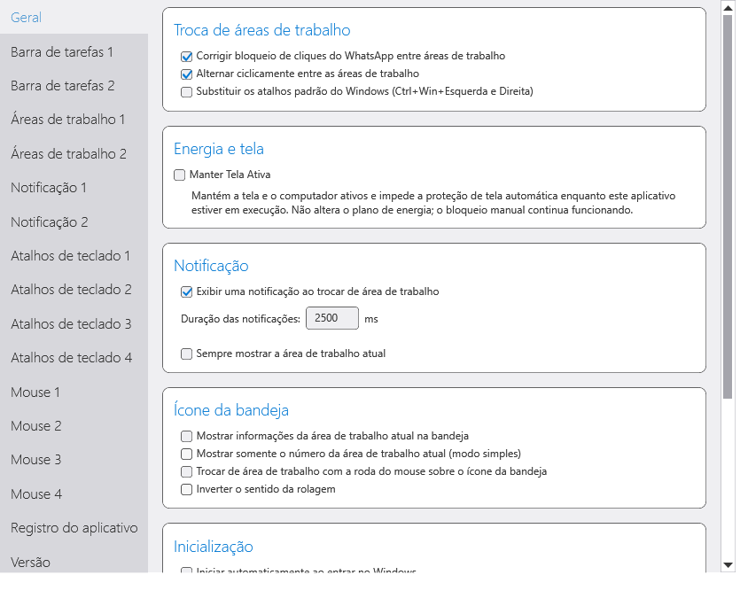

<div align="center">

## English


# SylphyHornPlus

**Your Windows virtual desktops, organized your way.**

Keyboard and mouse shortcuts, desktop notifications, taskbar information and practical fixes for everyday multitasking.


[](https://github.com/ThomasTrovon/SylphyHornPlus/releases)

[Português (Brasil)](#português-brasil) · [Source](https://github.com/ThomasTrovon/SylphyHornPlus) · [Issues](https://github.com/ThomasTrovon/SylphyHornPlus/issues)

</div>

## What it is

SylphyHornPlus is a tray application for Windows virtual desktops: switch desktops, move and pin windows, customize notifications and backgrounds, and display desktop information on the taskbar.

This independent fork extends [Asteski/SylphyHornPlus](https://github.com/Asteski/SylphyHornPlus), which builds on hwtnb's Windows 11 adaptations and the original SylphyHorn. It adds Brazilian Portuguese, reorganized settings, shortcut reliability fixes, an optional WhatsApp workaround and a built-in keep-awake option.

## Highlights

| Area | Features |
|---|---|
| Keyboard and mouse | Configurable shortcuts, direct desktop selection, wheel navigation and left/right/either modifier selection |
| Organization | Names, wallpapers, moving/pinning windows and application routing |
| Taskbar and tray | Desktop number/name, appearance, tooltips and click actions |
| Settings | Cards across all tabs, searchable selectors and revised notification layout |
| Languages | English, Brazilian Portuguese and inherited Japanese resources; newer Japanese strings may fall back to English |
| WhatsApp | Optional workaround for invisible windows intercepting clicks across desktops |
| Keep Screen Active | Keeps the system/display awake and prevents automatic screen saver activation |

<div align="center">



*Actual settings interface in Brazilian Portuguese.*

</div>

## Compatibility and requirements

| Requirement | Details |
|---|---|
| Operating system | Windows 10 or 11; upstream minimum is Windows 10 build 14393 |
| Runtime for this package | .NET Framework 4.8 |
| Distribution | Portable folder; extract the entire archive |
| Administrator access | Optional for normal use; required to register elevated startup |
| Validation | Release build and regression checks on Windows 11; not validated on every Windows build or ARM |

Virtual desktop integration uses Windows interfaces that can change between OS releases. Future Windows updates may require adaptations.

## Installation and use

1. Download the package from this fork's [Releases](https://github.com/ThomasTrovon/SylphyHornPlus/releases).
2. Extract the complete folder to a permanent location.
3. Run `SylphyHorn.exe`, keeping `lib`, language folders and `SchedulerManager.exe` alongside it.
4. Open settings from the tray icon.
5. Choose your language and configure shortcuts, mouse actions, desktop names and notifications.

Close other SylphyHorn/SylphyHornPlus copies before running this version. To update, exit the application and replace its program files while preserving your settings.

### WhatsApp click-blocking workaround

Enable the WhatsApp option in **General** if an invisible region stops accepting clicks while WhatsApp is open on another virtual desktop.

A background thread identifies qualifying transparent WhatsApp windows outside the current desktop and makes them click-through. It tracks its own changes and restores them when appropriate or when disabled. It does not close WhatsApp or minimize its visible window. This addresses a specific window behavior, not every possible WhatsApp issue.

### Keep Screen Active

Enable **Keep screen active** in **General → Energy and screen**, or use the same option in the tray context menu. Hover over either checkbox for a tooltip explaining both effects.

A thread in the existing process owns a Windows power request for the system/display. When necessary, a zero-distance relative mouse event renews idle activity, because a power request alone does not stop the screen saver. It does not move the pointer, click or type, and does not change the power plan or screen saver configuration.

Disabling the option or exiting releases the request. Manual locking remains available; the service suspends activity on secure desktops. Windows policies or input restrictions can prevent idle renewal, in which case the application reports the failure. This prevents automatic activation; it does not dismiss an already active screen saver.

### Startup and configuration

Use **General → Startup** for automatic startup, including administrator mode. Accept UAC when registering elevated startup. The helper registers a task for the current user's interactive logon; keep the installation path stable afterward.

Settings remain in `%LOCALAPPDATA%\Asteski\SylphyHornPlus\Settings.xml` for compatibility. Back up that file before migration; import/export is also available in settings.

## Troubleshooting

| Symptom | What to check |
|---|---|
| Shortcuts stop responding | Conflicts and duplicate instances; this version resynchronizes modifiers and restores hooks on unlock/resume |
| Elevated startup fails | Presence of `SchedulerManager.exe`, UAC approval and the displayed error |
| Desktop clicks remain blocked | Enable the workaround and verify that WhatsApp owns the blocked region |
| Screen saver still starts | Verify Keep Screen Active is enabled and inspect policy/input errors |
| Settings do not reopen | This version avoids reusing closed settings windows |
| Failure after a Windows update | Record the Windows build, application log and reproduction steps |

The historical intermittent shortcut failure was not conclusively reproduced. The fixes address identified hook lifecycle/state defects; they do not establish that every shortcut conflict is eliminated.

## Development and build

Use Windows, a compatible .NET SDK/MSBuild installation and .NET Framework targeting packs. This release uses .NET SDK 8.0.427 targeting `net48`. The project also declares `net472`, which is not the release artifact documented here.

```powershell
git clone --recurse-submodules https://github.com/ThomasTrovon/SylphyHornPlus.git
Set-Location SylphyHornPlus
dotnet build source/SylphyHorn/SylphyHorn.csproj -c Release -f net48 --disable-build-servers -p:UseSharedCompilation=false -p:OutputPath=bin/Candidate/
```

Output: `source/SylphyHorn/bin/Candidate/`. Distribute the complete folder, not only the main executable.

### Regression checks

```powershell
dotnet build tests/Regression/Regression.csproj -c Release --disable-build-servers -p:UseSharedCompilation=false
& ./tests/Regression/bin/Release/net48/Regression.exe ./source/SylphyHorn/bin/Candidate/SylphyHorn.exe
```

Checks cover modifiers, shortcuts, mouse handling, translation coverage, packaging and settings bindings. Interactive modes `--layout <output-folder>` and `--awake` exercise real Windows behavior: close the running application before using them. Layout mode loads real user settings and writes previews; awake mode temporarily renews idle activity. These modes are not headless CI tests.

## Project structure

```text
source/
├── SylphyHorn/                   # WPF application, UI and services
├── SylphyHorn.Core/              # Shared types and settings
├── SylphyHorn.SchedulerManager/  # Elevated startup helper
├── VirtualDesktop/              # Virtual desktop integration submodule
└── libraries/                    # Existing UI dependencies
tests/Regression/                # Regression and interactive checks
docs/images/                     # README screenshots
```

## License

[MIT License](LICENSE.txt). Original notices and embedded third-party license information are preserved.

## Credits

- [Thomas Nilton de Carvalho Vanini (@ThomasTrovon)](https://linktr.ee/ThomasVanini) — maintainer of this fork; feature direction, Brazilian Portuguese, settings redesign, shortcut/startup improvements, WhatsApp workaround, Keep Screen Active, regression coverage and real-world validation.
- [Asteski](https://github.com/Asteski/SylphyHornPlus) — upstream SylphyHornPlus development, taskbar deskband and additional desktop features.
- [hwtnb](https://github.com/hwtnb) — SylphyHornPlusWin11 and Windows 11 adaptations.
- [Manato KAMEYA (@Grabacr07)](https://github.com/Grabacr07/SylphyHorn) — original SylphyHorn author/developer.
- [Yutaka TSUMORI (@tmyt)](https://github.com/tmyt) — original developer.
- Maintainers of VirtualDesktop, MetroRadiance, MetroTrilithon, Livet and the other dependencies credited in the application's license panel.

---

<div align="center">

## Português (Brasil)


# SylphyHornPlus

**Suas áreas de trabalho do Windows, organizadas do seu jeito.**

Atalhos de teclado e mouse, notificações, informações na barra de tarefas e correções práticas para trabalhar com várias áreas.


[](https://github.com/ThomasTrovon/SylphyHornPlus/releases)

[English](#english) · [Código-fonte](https://github.com/ThomasTrovon/SylphyHornPlus) · [Problemas](https://github.com/ThomasTrovon/SylphyHornPlus/issues)

</div>

## O que é

O SylphyHornPlus é um aplicativo de bandeja para áreas virtuais do Windows: alterna áreas, move e fixa janelas, personaliza notificações e fundos e mostra informações da área na barra de tarefas.

Este fork independente amplia o [Asteski/SylphyHornPlus](https://github.com/Asteski/SylphyHornPlus), que parte das adaptações de hwtnb para Windows 11 e do SylphyHorn original. Acrescenta Português do Brasil, configurações reorganizadas, correções de confiabilidade dos atalhos, uma solução opcional para o WhatsApp e uma opção integrada para manter a tela ativa.

## Destaques

| Área | Funcionalidades |
|---|---|
| Teclado e mouse | Atalhos configuráveis, seleção direta de área, navegação pela roda e modificadores esquerdo/direito/qualquer lado |
| Organização | Nomes, papéis de parede, movimentação/fixação de janelas e direcionamento de aplicativos |
| Barra de tarefas e bandeja | Número/nome da área, aparência, dicas e ações de clique |
| Configurações | Cartões em todas as abas, seletores com pesquisa e notificações com disposição revisada |
| Idiomas | Inglês, Português do Brasil e recursos japoneses herdados; textos novos podem aparecer em inglês no japonês |
| WhatsApp | Correção opcional para janelas invisíveis que interceptam cliques entre áreas |
| Manter Tela Ativa | Mantém o sistema e a tela ativos e impede a proteção de tela automática |

<div align="center">


*Interface real das configurações em Português do Brasil.*

</div>

## Compatibilidade e requisitos

| Requisito | Detalhes |
|---|---|
| Sistema operacional | Windows 10 ou 11; o mínimo informado pelo projeto original é Windows 10 build 14393 |
| Runtime deste pacote | .NET Framework 4.8 |
| Distribuição | Pasta portátil; extraia o arquivo inteiro |
| Acesso administrativo | Opcional para uso normal; necessário para registrar a inicialização elevada |
| Validação | Compilação Release e verificações de regressão no Windows 11; não validado em todas as builds do Windows nem em ARM |

A integração com áreas virtuais utiliza interfaces do Windows que podem mudar entre versões do sistema. Atualizações futuras podem exigir adaptações.

## Instalação e uso

1. Baixe o pacote na página de [versões deste fork](https://github.com/ThomasTrovon/SylphyHornPlus/releases).
2. Extraia a pasta completa para um local permanente.
3. Execute `SylphyHorn.exe`, mantendo `lib`, as pastas de idiomas e `SchedulerManager.exe` junto dele.
4. Abra as configurações pelo ícone da bandeja.
5. Escolha o idioma e configure atalhos, ações do mouse, nomes das áreas e notificações.

Feche outras cópias do SylphyHorn/SylphyHornPlus antes de executar esta versão. Para atualizar, encerre o aplicativo e substitua os arquivos de programa preservando suas configurações.

### Correção do bloqueio de cliques do WhatsApp

Ative a opção do WhatsApp em **Geral** se uma região invisível deixar de aceitar cliques enquanto o WhatsApp estiver aberto em outra área virtual.

Uma thread identifica janelas transparentes do WhatsApp que atendem aos critérios fora da área atual e permite que os cliques atravessem essas janelas. Ela acompanha suas próprias alterações e restaura o estado quando apropriado ou ao desativar a opção. Não fecha o WhatsApp nem minimiza sua janela visível. Trata um comportamento específico de janela, não todos os problemas possíveis do WhatsApp.

### Manter Tela Ativa

Ative **Manter Tela Ativa** em **Geral → Energia e tela**, ou use a mesma opção no menu de contexto da bandeja. Passe o mouse sobre qualquer uma das opções para visualizar a dica que explica os dois efeitos.

Uma thread no processo existente mantém uma solicitação de energia para o sistema e a tela. Quando necessário, um evento de movimento relativo de mouse com distância zero renova a atividade ociosa, pois a solicitação de energia sozinha não impede o protetor. Não desloca o cursor, não clica nem digita e não altera o plano de energia ou a configuração da proteção de tela.

Desativar a opção ou encerrar o aplicativo libera a solicitação. O bloqueio manual permanece disponível; o serviço suspende a atividade nas telas seguras. Políticas do Windows ou restrições de entrada podem impedir a renovação de atividade, situação em que o aplicativo informa a falha. A opção impede a ativação automática; não dispensa uma proteção de tela já ativa.

### Inicialização e configurações

Use **Geral → Inicialização** para executar automaticamente, inclusive como administrador. Aceite o UAC ao registrar a inicialização elevada. O auxiliar registra uma tarefa para o logon interativo do usuário atual; mantenha o caminho da instalação estável depois disso.

As configurações permanecem em `%LOCALAPPDATA%\Asteski\SylphyHornPlus\Settings.xml` por compatibilidade. Faça uma cópia desse arquivo antes de migrar; importação/exportação também estão disponíveis nas configurações.

## Solução de problemas

| Sintoma | O que conferir |
|---|---|
| Atalhos param de responder | Conflitos e instâncias duplicadas; esta versão sincroniza modificadores e restaura os hooks ao desbloquear/retomar |
| Inicialização elevada falha | Presença de `SchedulerManager.exe`, aprovação do UAC e erro exibido |
| Cliques continuam bloqueados | Ative a correção e confirme se o WhatsApp é responsável pela região bloqueada |
| Proteção de tela ainda inicia | Confirme que Manter Tela Ativa está habilitado e confira erros de política/entrada |
| Configurações não reabrem | Esta versão evita reutilizar janelas de configuração já encerradas |
| Falha após atualização do Windows | Anote a build do Windows, o registro do aplicativo e os passos de reprodução |

A falha intermitente histórica dos atalhos não foi reproduzida conclusivamente. As correções tratam defeitos identificados de estado e ciclo de vida dos hooks; não comprovam a eliminação de todos os conflitos de atalhos.

## Desenvolvimento e compilação

Utilize Windows, uma instalação compatível do .NET SDK/MSBuild e os pacotes de referência do .NET Framework. Esta entrega utiliza .NET SDK 8.0.427 para `net48`. O projeto também declara `net472`, que não é o artefato de entrega documentado aqui.

```powershell
git clone --recurse-submodules https://github.com/ThomasTrovon/SylphyHornPlus.git
Set-Location SylphyHornPlus
dotnet build source/SylphyHorn/SylphyHorn.csproj -c Release -f net48 --disable-build-servers -p:UseSharedCompilation=false -p:OutputPath=bin/Candidate/
```

Saída: `source/SylphyHorn/bin/Candidate/`. Distribua a pasta completa, não apenas o executável principal.

### Verificações de regressão

```powershell
dotnet build tests/Regression/Regression.csproj -c Release --disable-build-servers -p:UseSharedCompilation=false
& ./tests/Regression/bin/Release/net48/Regression.exe ./source/SylphyHorn/bin/Candidate/SylphyHorn.exe
```

As verificações cobrem modificadores, atalhos, tratamento do mouse, traduções, empacotamento e vínculos das configurações. Os modos interativos `--layout <pasta-de-saída>` e `--awake` exercitam o comportamento real do Windows: feche o aplicativo em execução antes de utilizá-los. O modo de layout carrega configurações reais e grava prévias; o modo de energia renova temporariamente a atividade ociosa. Esses modos não são testes de CI sem interface gráfica.

## Estrutura do projeto

```text
source/
├── SylphyHorn/                   # Aplicativo WPF, interface e serviços
├── SylphyHorn.Core/              # Tipos compartilhados e configurações
├── SylphyHorn.SchedulerManager/  # Auxiliar de inicialização elevada
├── VirtualDesktop/              # Submódulo de integração com áreas virtuais
└── libraries/                    # Dependências existentes da interface
tests/Regression/                # Verificações de regressão e interativas
docs/images/                     # Capturas utilizadas no README
```

## Licença

[Licença MIT](LICENSE.txt). Os avisos originais e as informações incorporadas de licenças de terceiros foram preservados.

## Créditos

- [Thomas Nilton de Carvalho Vanini (@ThomasTrovon)](https://linktr.ee/ThomasVanini) — mantenedor deste fork; direcionamento das funcionalidades, Português do Brasil, reorganização das configurações, melhorias de atalhos/inicialização, correção do WhatsApp, Manter Tela Ativa, cobertura de regressão e validação no uso real.
- [Asteski](https://github.com/Asteski/SylphyHornPlus) — desenvolvimento do SylphyHornPlus de origem, deskband e funcionalidades adicionais para áreas virtuais.
- [hwtnb](https://github.com/hwtnb) — SylphyHornPlusWin11 e adaptações para Windows 11.
- [Manato KAMEYA (@Grabacr07)](https://github.com/Grabacr07/SylphyHorn) — autor/desenvolvedor do SylphyHorn original.
- [Yutaka TSUMORI (@tmyt)](https://github.com/tmyt) — desenvolvedor original.
- Mantenedores de VirtualDesktop, MetroRadiance, MetroTrilithon, Livet e das demais dependências creditadas no painel de licenças do aplicativo.
